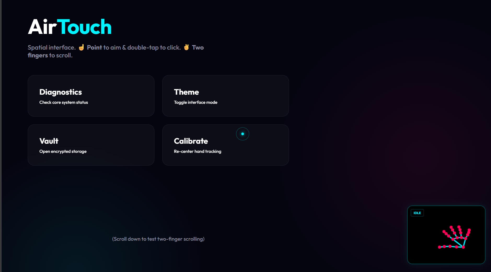
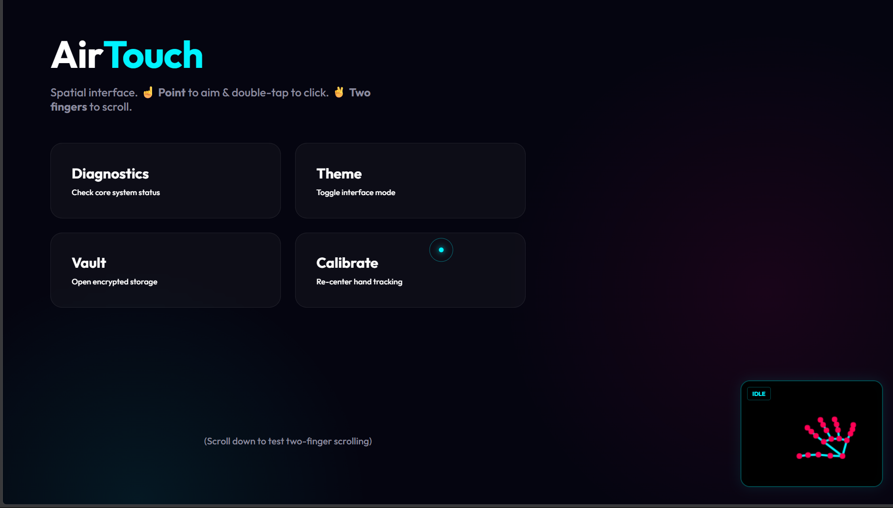
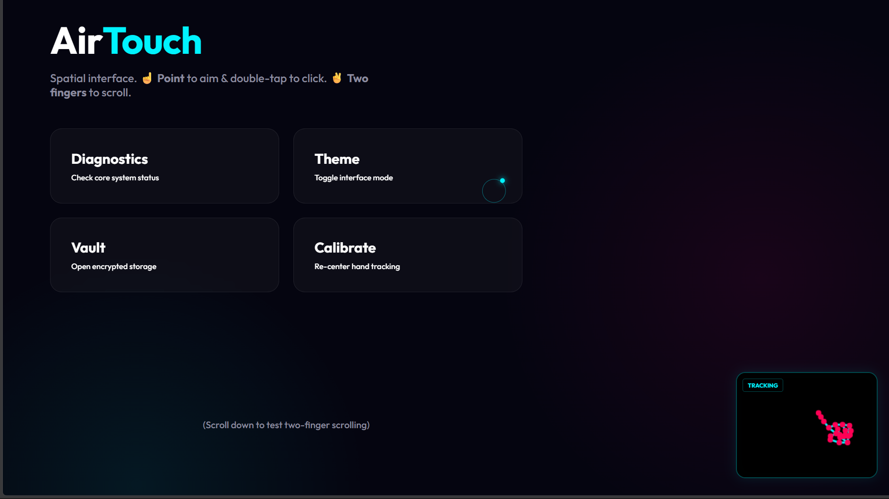
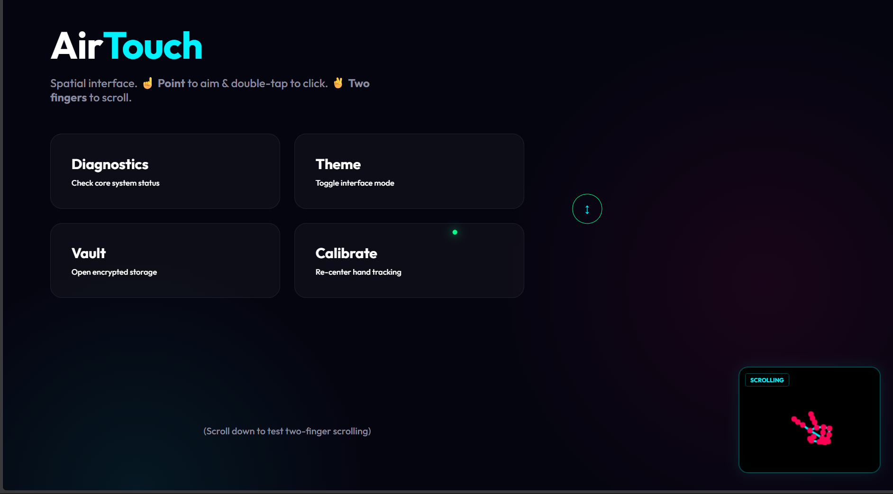

# AirTouch

A touchless web interface that allows users to control a webpage using hand gestures via their webcam. Built entirely with Vanilla JavaScript and MediaPipe.
 
 [](https://opensource.org/licenses/MIT)

**Live Demo:** [https://iromzi.github.io/Air-Touch/](https://iromzi.github.io/Air-Touch//)



## Overview

AirTouch is a client-side spatial tracking application. It translates 21 hand landmarks captured from the user's webcam into screen coordinates, allowing them to move a cursor, click, drag elements, and scroll without touching a mouse or screen. The application prioritizes privacy by rendering only the skeletal data to the UI, never the raw video feed.

<div align="center">
  
  
  
</div>

## Features

- **Cursor Tracking:** Move the index finger to control the cursor on the screen.
- **Clicking:** A quick pinch (thumb and index finger) and release triggers a click.
- **Drag and Drop:** A sustained pinch (held for 250ms) grabs an element, allowing it to be dragged. Releasing the pinch drops it.
- **Scrolling:** Holding up two fingers and moving the hand vertically scrolls the page.

## Technical Architecture

- **Client-Side Machine Learning:** Uses Google's MediaPipe Hands via WebGL. Inference runs entirely in the browser, ensuring low latency and data privacy.
- **Decoupled Render Loop:** The ML inference (which runs at ~30 FPS) is decoupled from the `requestAnimationFrame` UI render loop. This allows the cursor to move at a smooth 60 FPS even if the ML model drops frames.
- **Gesture State Machine:** A custom state machine (`IDLE`, `POINTING`, `PINCHING`, `SCROLLING`, `DRAGGING`) manages interaction logic. This prevents overlapping inputs, such as accidental clicks while scrolling.
- **Dynamic Smoothing:** Cursor movement uses linear interpolation (lerp). The smoothing factor dynamically adjusts based on the distance between the user's hand and the cursor position, making fast movements responsive and slow movements stable.
- **Coordinate Mapping:** Handles the mathematical inversion of X/Y coordinates to account for the mirrored webcam feed, ensuring physical hand movement aligns naturally with digital cursor movement.

## Tech Stack

- **HTML5/CSS3:** Custom UI with a dark glassmorphism aesthetic.
- **Vanilla JavaScript:** No frontend frameworks (React, Vue, etc.) used.
- **MediaPipe Hands:** For real-time hand landmark detection.
- **HTML5 Canvas:** For rendering the skeletal radar overlay.

## Running Locally

Because web browsers require an HTTPS connection or `localhost` to access the webcam, you cannot simply open the HTML file directly.

1. Clone the repository:
   ```bash
   git clone https://github.com/Mohamxd-Fathy/Air-Touch.git
